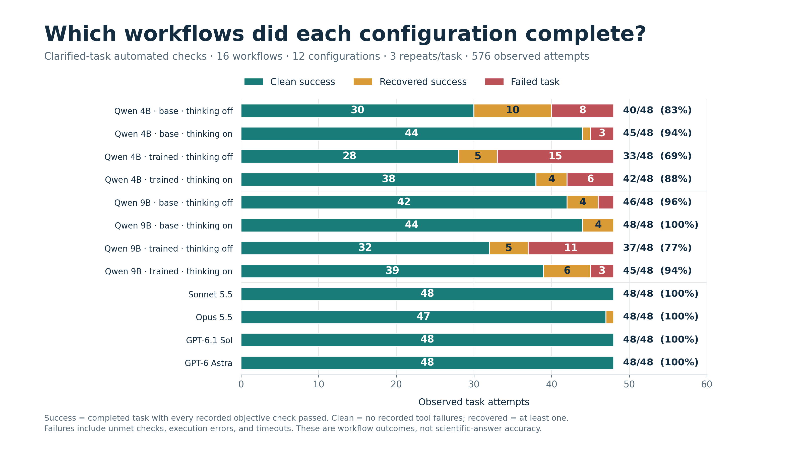
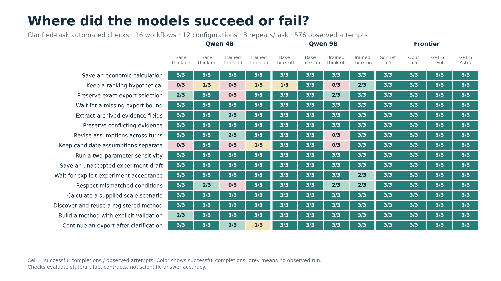

# LanM model comparison 18 November 2026

Twelve configurations were evaluated on the same 16 development workflow templates, with three attempts per workflow. The comparison includes Qwen 4B and 9B, each base/trained with thinking off/on, plus Sonnet, Opus, Sol and Astra. Success means completed execution and all saved-state/artifact checks passed; it is not a scientific-answer accuracy score.

The original authored-method prompt had ambiguous boundary and rejection wording. A prespecified clarification reran that one task three times for every configuration. Corrected scores replace all 36 original authored-method attempts, regardless of outcome, while retaining the other 540. There are 612 raw attempts and 576 corrected headline attempts; the original strict scores remain separately available.

| Configuration | Original strict | Corrected | Recovered successes | Failed calls / all calls | Completed median seconds (n) |
|---|---:|---:|---:|---:|---:|
| Qwen 4B · base · thinking off | 38/48 | 40/48 | 10 | 22/147 | 8.09 (48) |
| Qwen 4B · base · thinking on | 44/48 | 45/48 | 1 | 14/118 | 14.38 (47) |
| Qwen 4B · trained · thinking off | 32/48 | 33/48 | 5 | 6/106 | 5.52 (47) |
| Qwen 4B · trained · thinking on | 41/48 | 42/48 | 4 | 18/128 | 10.62 (47) |
| Qwen 9B · base · thinking off | 45/48 | 46/48 | 4 | 7/118 | 12.15 (48) |
| Qwen 9B · base · thinking on | 46/48 | 48/48 | 4 | 4/118 | 20.11 (48) |
| Qwen 9B · trained · thinking off | 37/48 | 37/48 | 5 | 8/95 | 8.63 (48) |
| Qwen 9B · trained · thinking on | 45/48 | 45/48 | 6 | 18/126 | 12.44 (47) |
| Sonnet 5.5 | 48/48 | 48/48 | 0 | 0/102 | 9.97 (48) |
| Opus 5.5 | 48/48 | 48/48 | 1 | 1/113 | 16.09 (48) |
| GPT-6.1 Sol | 48/48 | 48/48 | 0 | 0/133 | 16.30 (48) |
| GPT-6 Astra | 48/48 | 48/48 | 0 | 0/125 | 16.70 (48) |

All four hosted configurations reached 48/48. This suite therefore provides no task-success ranking among them. Descriptive latency differences do not establish a general capability ranking.

A recovered success contains at least one rejected tool call before meeting the task checks. A task can also fail while every tool call succeeds, for example by saving the wrong scope or omitting a requested calculation. Error categories describe observed responses and do not automatically assign a root cause.

The trained conditions use actual learned LoRA adapters, with artifact/data hashes and runtime identities in the aggregate JSON. See [training results](../../local-training/training-results.json) for the separate held-out loss measurements. Training loss and workflow success are different measurements.

## Observed failure patterns

In the trained 9B configuration with thinking off, all three follow-up assumption revisions claimed saved changes and new calculations without making second-turn tool calls. The required tools were available, but the earlier saved state and its single calculation remained unchanged. Candidate-only scope also failed in all three attempts by changing shared assumptions.

For that configuration, 8 of 11 corrected task failures had no explicitly rejected tool call. Successful tool execution therefore cannot substitute for checking the requested saved state. The trace audit also separates a missing candidate-specific calculation from actual use of mismatched experimental measurements; the check's label alone does not establish that cause.

Other audited examples include an omitted requested random seed, failing to carry an earlier turn's bound into a later export, and repeated calls using an altered project ID. These are observed workflow failures, not an explanation of why adaptation changed the model. The [qualitative findings](qualitative-findings.json) retain diagnostic hashes and paraphrases; raw excerpts stay local.

## Coverage and interpretation

The corrected runs attempted 27 distinct allowed LanM tools. Research mode allowed 33 tools and Build mode 36, from a 41-tool platform inventory. Archived literature was tested; live PubMed retrieval and robot execution were excluded.

These are 16 templates repeated three times, not 48 or 144 independent tasks. No confidence interval, significance claim, or blind scientific-accuracy score is inferred. Configurations include their serving/runtime differences; frontier hardware, queueing, caching and model warmness were not controlled. Clarified attempts ran later, so latency medians are descriptive and retain their completed-attempt counts.

## Files

`corrected-aggregate.json` and `original-strict-aggregate.json` contain model/task/tool totals, usage coverage, exact configured model identities and raw-report filenames/hashes. Paired tables compare training and thinking within size. PNG/SVG figures include aggregate plotted-data sidecars. Raw prompts, answers, conversations, source excerpts, tool arguments and machine paths are excluded; the full audit evidence is retained locally.

The frozen benchmark report serializer omitted training-specific profile metadata. The [runtime identity evidence](runtime-identity-evidence.json) separately verifies the full profile file against its executed-plan checksum, the exact report-visible profile projection, recorded per-report adapter identities, and completed queue report hashes. This provenance addition changes no raw report or score.
